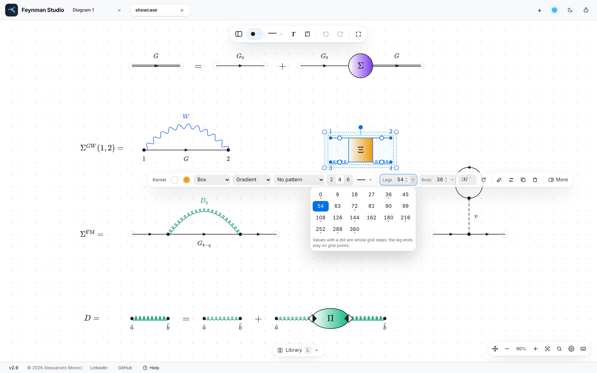
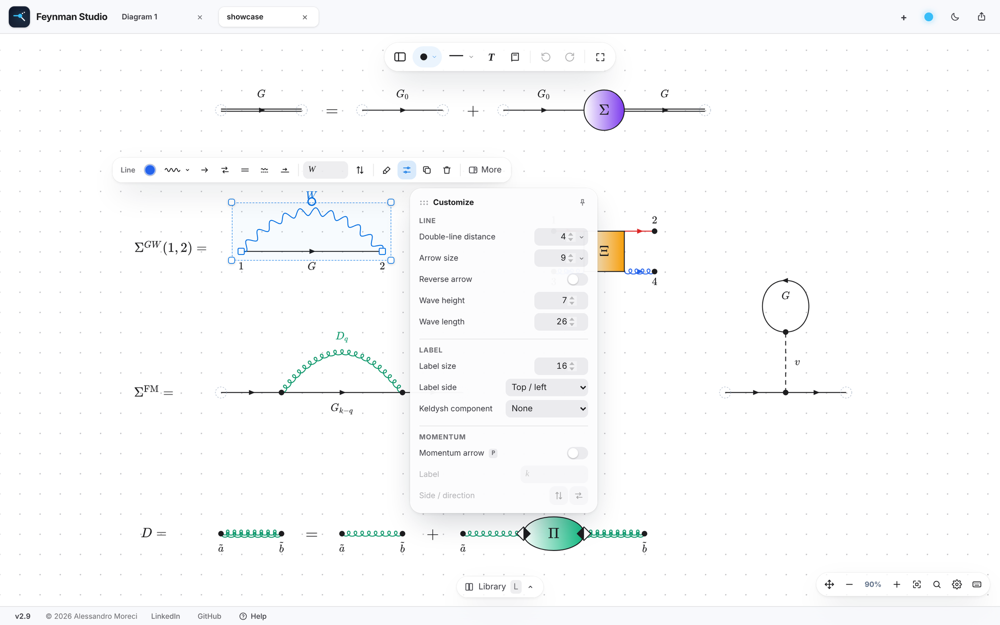
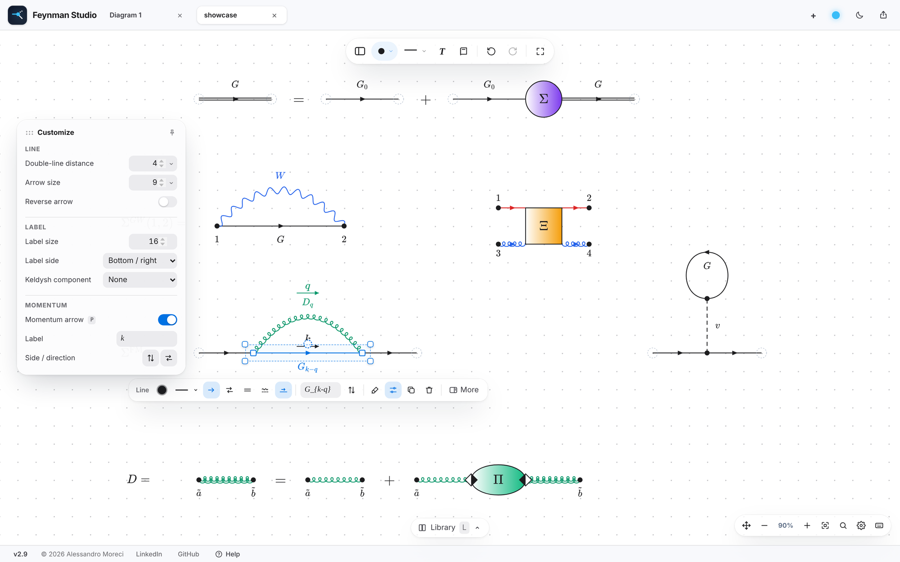
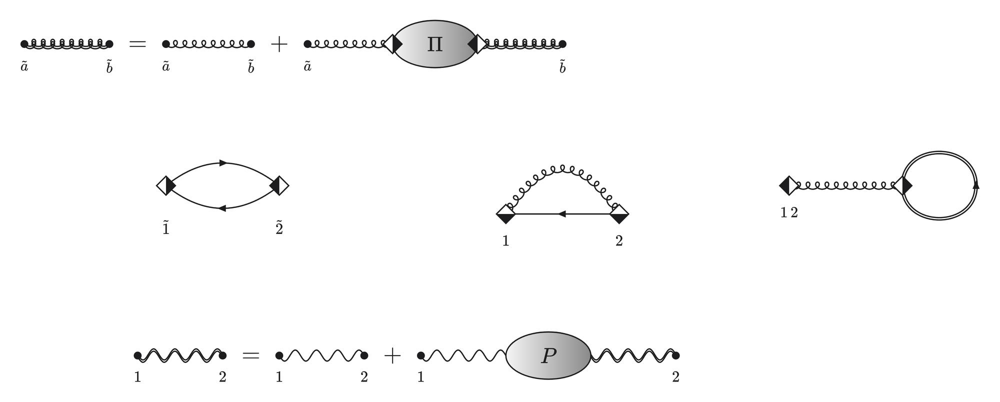
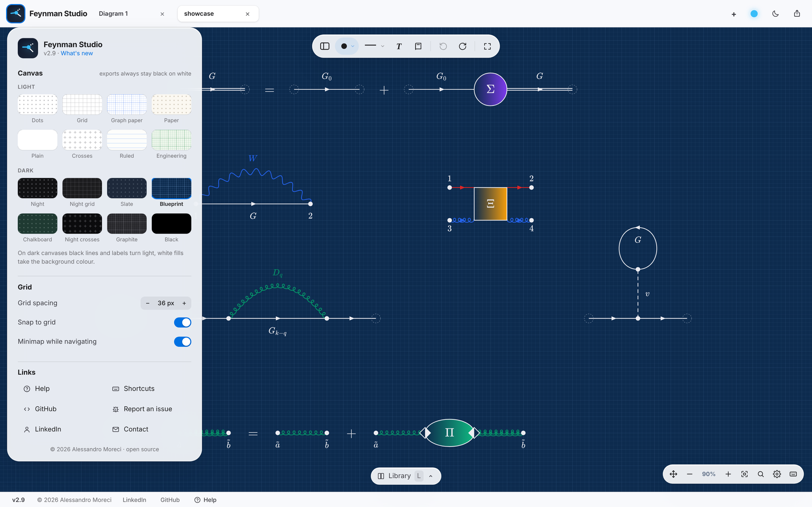
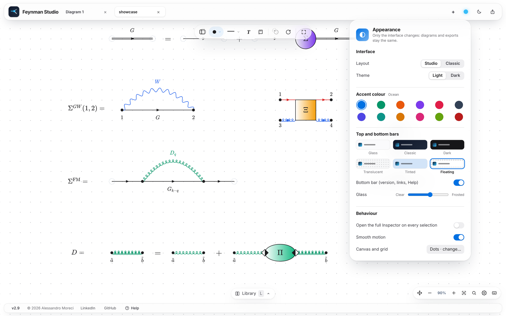

<p align="center">
  
</p>

<h1 align="center">Feynman Studio</h1>

<p align="center">
  <b>A diagram editor for many-body physics.</b><br>
  Draw Green's functions, self-energies, phonon propagators and vertex kernels, label them in LaTeX,<br>
  and export to TikZ, SVG, PDF or PNG, all inside your browser.
</p>

<p align="center">
  <a href="https://alessandromoreci.github.io/Feynman-Studio/"></a>
  &nbsp;
  <a href="https://github.com/alessandromoreci/Feynman-Studio/archive/refs/heads/main.zip"></a>
</p>

<p align="center">
  <sub>Version 2.9 · one HTML file · no installation · no account · your diagrams never leave your computer</sub>
</p>

<br>

<p align="center">
  
</p>

<br>

## Draw a diagram in seconds

Click to place a vertex and click two vertices to join them. Double-click a line to select it: its main properties appear right above it, in the **selection bar**. Change the propagator, bend the line by dragging its handle, colour and label it. Lines always start and end exactly on their vertices, and everything snaps to the grid.

<p align="center">
  
</p>

<br>

## A canvas that leaves room for the physics

The canvas fills the window and the tools come to you when you need them:

- **The logo** (top left) opens the canvas menu: 16 canvases, light and dark, grid spacing, snap to grid, minimap, and the links (Help, shortcuts, GitHub, report an issue).
- **The tool bar** above the canvas: tool panel, vertex shape, line style, text, library, undo and redo, focus mode.
- **The selection bar** appears right above whatever you select. **Customize** opens the finer settings in a small panel; **More** (or <kbd>I</kbd>) opens the full Inspector with every property.
- **The Library** (<kbd>L</kbd>) slides up from the bottom with diagrams, kernels, icons and your own templates.
- **Export** has its own icon at the top right, next to the light / dark switch (<kbd>Ctrl</kbd>/<kbd>⌘</kbd> + <kbd>E</kbd>).

Prefer the side panels of earlier versions? *Appearance → Layout → Classic* brings them back, with every feature.

<br>

## Every propagator you need

Ten line styles: solid (fermion), dashed, dotted, dash-dot, sine (photon, interaction), square wave, zig-zag, coil, gluon and phonon. The number of waves and curls adapts to the length of the line, and asymmetric patterns can be mirrored with <kbd>M</kbd>. Lines can carry an arrow, be doubled (dressed propagators), bent into arcs or closed into self-loops; wave height, wave length and the distance of double lines can be tuned for each line. Keys <kbd>1</kbd> … <kbd>9</kbd>, <kbd>0</kbd> pick the style.

<p align="center">
  
</p>

<br>

## Edit right where you are

<p align="center">
  
</p>

- **Selection bar:** colour, shape or style, size, label, arrow, rotation, pattern, legs… every change is one undo step.
- **Ready-made sizes:** the small ▾ next to every size or angle opens a grid of values. Leg lengths and body sizes go in quarter-grid steps; the values marked with a dot keep the leg ends on grid points.
- **Customize** (the sliders button) opens a small panel with the finer settings of what is selected: double-line distance, arrow size and direction, wave height and length, label size and side for lines; leg arrows, border, gradient, pattern density, vertices and labels for blocks; label size and colours for vertices; background for texts. Pin it to keep it open while you move from one element to the next, or drag it by its title anywhere on the canvas.
- **Copy & paste style:** <kbd>Ctrl</kbd>/<kbd>⌘</kbd>+<kbd>Alt</kbd>+<kbd>C</kbd> on one element, <kbd>Ctrl</kbd>/<kbd>⌘</kbd>+<kbd>Alt</kbd>+<kbd>V</kbd> on others (or the brush in the selection bar): colours, line style, double line, arrows, waves, shapes, fills, borders — never positions, connections or labels.
- **Nothing covers what you are editing:** the selection bar, the Customize panel and every menu opened from them keep clear of the whole diagram you are working on and prefer empty space.
- **Vertex shapes with previews:** the shape button opens a grid of every shape — filled, outline, concentric and two-colour circles, squares, triangles, diamonds, hexagons, stars, crosses.
- **Full Inspector** with **More** or <kbd>I</kbd>: it stays open for the next selections until you close it.
- **Smart guides** show alignment and equal spacing while you drag vertices, blocks and texts; elements glide from one grid point to the next, and the selection bar glides to the next selection.
- **Resize from the selection frame:** drag a corner to scale anything, from one icon to a whole diagram.
- **A click that only closes never draws:** after a menu, a popover or <kbd>Esc</kbd>, the first click on the empty canvas just closes and deselects.
- **Command palette:** <kbd>Ctrl</kbd>/<kbd>⌘</kbd> + <kbd>K</kbd>, type what you want to do. **Undo** works for every drag and every edit.

<p align="center">
  
</p>

### Momentum arrows and Keldysh labels

Press <kbd>P</kbd> on selected lines (or the arrow button of the selection bar): a small arrow with its label — *k* on fermion lines, *q* on bosons — appears on the freer side of each line. It follows the line when it moves, turns or bends; drag it or its label to place them, and change label, side and direction in Customize. Momentum arrows are copied, exported (PNG, PDF, SVG, TikZ) and deleted together with their line. <kbd>K</kbd> cycles the Keldysh branch of the selected vertices (none, −, +, M); the Keldysh component of a line (&lt;, &gt;, R, A, M…) is in Customize.

<p align="center">
  
</p>

<br>

## Kernels, built leg by leg

Vertex functions, self-energy blobs and four-point kernels are single blocks with 2, 4 or 6 legs (3 for triangles). The body can be a **box, circle, ellipse or triangle**, with a solid or gradient fill and a pattern inside: **none, grid, horizontal lines or vertical lines**.

**Every leg is independent:** its own line style, colour, arrow direction, length and position along the side. Set them in the Inspector, or drag the handle in the middle of a leg on the canvas. Lines attached to a block follow it when you move, rotate or mirror it.

<p align="center">
  
</p>

<br>

## A library to start from

<p align="center">
  
</p>

Twelve ready-made diagrams, without labels so you can use your own notation: Hartree, Fock, polarization bubble, *GW*, Fan–Migdal, Debye–Waller, the Dyson equation, and the **electron–phonon** ones in the notation of Stefanucci and Perfetto — the phonon propagator *D* as a spring and the coupling *g* as a rhombus whose black half holds the electron vertex:

<p align="center">
  
</p>

phonon Dyson equation *D = D₀ + D₀ΠD*, phonon self-energy Π, Fan self-energy with *g* vertices, Ehrenfest self-energy and screened interaction *W = v + vPW*. Click a tile to put it in the middle of the view, or drag it exactly where you want it. Save any selection as a template of your own (the star in the selection bar); in *My templates* you can rename and delete them. Every tab of the Library has the same size and its tiles fill it, so nothing hides behind a scroll bar.

<br>

## Icons that explain a diagram

<p align="center">
  
</p>

**Explain a diagram:** scissors where a diagram is cut (one- or two-particle reducible), included / excluded, caution, zoom into a block, self-consistency, static, quench, laser pulse, time evolution, temperature, counterterm, probe, key idea, leads to, approximation, open question, note.
**Physics:** honeycomb lattice, K / K′ valleys, exciton, circular polarization, photoemission, optical cavity, lattice vibrations, coherent phonons, atom, conserving approximation, memory, detailed balance, spectral function, lifetime, collision integral, resummation, ab initio, band structure.

Icons move, rotate, resize and take a colour like any text, and they are exported to every format, TikZ included.

<br>

## LaTeX, right where you need it

Every label is LaTeX, typeset live: vertex labels, line labels, kernel labels and free text. **Double-click a label to edit it in place** on the canvas; <kbd>Enter</kbd> applies the change and <kbd>Esc</kbd> cancels it. There is a symbol palette with search (*alpha*, *sum*, *hbar*…), label presets (*G*, *G*₀, *W*, *v*, Σ, Π, *D*…), and Keldysh components (<, >, R, A, M…) added to a line label in one click.

<br>

## Export for papers, theses and slides

<p align="center">
  
</p>

| Format | Use it for |
|---|---|
| **TikZ** | pasting into a LaTeX document: lines, curves, loops, kernels, every vertex shape and icons come out as on the canvas |
| **SVG** | vector figures, with labels converted to paths |
| **PDF / PNG** | from 1× to 8×, cropped to the diagram, optional transparent background |
| **Figure width** | APS one column (8.6 cm), two columns (17.8 cm), thesis (15 cm) or custom |
| **Clipboard** | <kbd>Ctrl</kbd>/<kbd>⌘</kbd>+<kbd>Shift</kbd>+<kbd>C</kbd> straight into slides or notes |
| **Share link** | the whole diagram inside a link, nothing uploaded |
| **Project (.json)** | the editable diagram, to reopen later |

**Selection only:** switch it on in Export (or use the export button of a multiple selection) to export just what is selected — lines bring the vertices they join. A live preview shows exactly what you will get, and an optional check flags overlapping labels, duplicated elements and LaTeX errors before you export. Dark canvases only change the screen: exports are always black on white.

<br>

## Your canvas, your colours

<p align="center">
  
  
</p>

- **16 canvases:** dots, grid, graph paper, paper, plain, crosses, ruled, engineering, and the dark ones — night, night grid, slate, blueprint, chalkboard, night crosses, graphite, black. On a dark canvas black lines and labels turn light and white fills take the background colour.
- **Appearance:** Studio or Classic layout, light or dark interface, **12 accent colours**, **six bar styles** — glass, classic, dark, translucent (the canvas runs under clear glass), tinted (glass with the accent colour) and floating (bars detached from the edges) — how much glass, smooth motion.

<p align="center">
  
</p>

<br>

## Getting started

1. **[Open the app](https://alessandromoreci.github.io/Feynman-Studio/)**, or download `index.html` and double-click it.
2. **Click** on the canvas to place vertices, then **click two vertices** to join them.
3. **Double-click** any element to select it and edit it from the selection bar; double-click a label to retype it.
4. Press <kbd>L</kbd> for the Library, <kbd>Ctrl</kbd>/<kbd>⌘</kbd> + <kbd>E</kbd> to export, <kbd>Ctrl</kbd>/<kbd>⌘</kbd> + <kbd>S</kbd> to save the editable project.

To see a full example, open [`examples/showcase.json`](examples/showcase.json), the diagram shown at the top. An illustrated ten-step guide is always available under **Help**, in the bottom bar and in the logo menu.

<p align="center">
  
</p>

<details>
<summary><b>Keyboard shortcuts</b></summary>
<br>

On macOS, use <kbd>⌘</kbd> instead of <kbd>Ctrl</kbd> and <kbd>⌥</kbd> instead of <kbd>Alt</kbd>.

| Action | Shortcut |
|---|---|
| Undo / redo | <kbd>Ctrl</kbd>+<kbd>Z</kbd> · <kbd>Ctrl</kbd>+<kbd>Shift</kbd>+<kbd>Z</kbd> |
| Copy / paste / duplicate | <kbd>Ctrl</kbd>+<kbd>C</kbd> · <kbd>Ctrl</kbd>+<kbd>V</kbd> · <kbd>Ctrl</kbd>+<kbd>D</kbd> |
| Save / open project | <kbd>Ctrl</kbd>+<kbd>S</kbd> · <kbd>Ctrl</kbd>+<kbd>O</kbd> |
| Export panel | <kbd>Ctrl</kbd>+<kbd>E</kbd> |
| Library | <kbd>L</kbd> |
| Full Inspector | <kbd>I</kbd> |
| Command palette | <kbd>Ctrl</kbd>+<kbd>K</kbd> |
| Line style | <kbd>1</kbd> … <kbd>9</kbd>, <kbd>0</kbd> |
| Mirror a line's pattern | <kbd>M</kbd> |
| External (transparent) vertex | <kbd>E</kbd> |
| Flip horizontally / vertically | <kbd>Shift</kbd>+<kbd>H</kbd> · <kbd>Shift</kbd>+<kbd>V</kbd> |
| Rotate 90° | <kbd>R</kbd> · <kbd>Shift</kbd>+<kbd>R</kbd> |
| Select the whole diagram | <kbd>Alt</kbd>+click |
| Add to the selection | <kbd>Shift</kbd>+click · drag a box on empty canvas |
| Place off the grid | hold <kbd>Alt</kbd> while dragging |
| Nudge the selection | arrow keys · <kbd>Shift</kbd>+arrows |
| Bring forward / send backward | <kbd>Ctrl</kbd>+<kbd>]</kbd> · <kbd>Ctrl</kbd>+<kbd>[</kbd> |
| Copy as image | <kbd>Ctrl</kbd>+<kbd>Shift</kbd>+<kbd>C</kbd> |
| Focus mode | <kbd>F</kbd> |
| Close / deselect | <kbd>Esc</kbd> |
| Zoom / pan | pinch or <kbd>Ctrl</kbd>+scroll · <kbd>Space</kbd>+drag |

</details>

<details>
<summary><b>How it works</b></summary>
<br>

- The whole application is a single file, `index.html`, written in plain HTML, CSS and JavaScript with no build step.
- Labels are typeset with [KaTeX](https://katex.org) on the canvas and with [MathJax](https://www.mathjax.org) for the exported figures. PDFs are written with [jsPDF](https://github.com/parallax/jsPDF). These libraries load from a CDN the first time the page opens.
- Nothing is uploaded anywhere. Your browser keeps only your interface preferences and a recovery copy of the open diagrams.
- Projects saved by earlier versions open unchanged; the older tight-curl phonon lines become the current phonon line.

</details>

<br>

## Citing Feynman Studio

If the app helped with the figures of a paper or thesis, a mention is appreciated:

```bibtex
@misc{FeynmanStudio,
  author       = {Moreci, Alessandro},
  title        = {{Feynman Studio}: a web editor for many-body {F}eynman diagrams},
  year         = {2026},
  version      = {2.9},
  howpublished = {\url{https://github.com/alessandromoreci/Feynman-Studio}}
}
```

## Feedback

Found a bug or have an idea? [Open an issue](https://github.com/alessandromoreci/Feynman-Studio/issues) and, if you can, attach the `.json` project that shows it.

<br>

<p align="center">
  Made by <a href="https://github.com/alessandromoreci"><b>Alessandro Moreci</b></a>, PhD student in theoretical condensed-matter physics at the University of Rome Tor Vergata<br>
  <a href="https://www.linkedin.com/in/alessandro-moreci-a35bbb247/">LinkedIn</a> · <a href="mailto:alessandromoreci27@gmail.com">Email</a>
</p>
