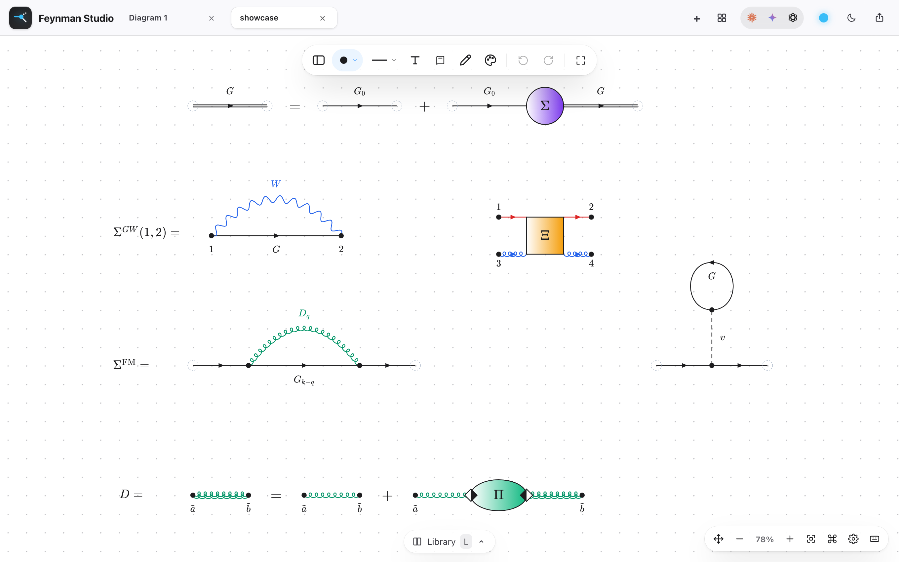
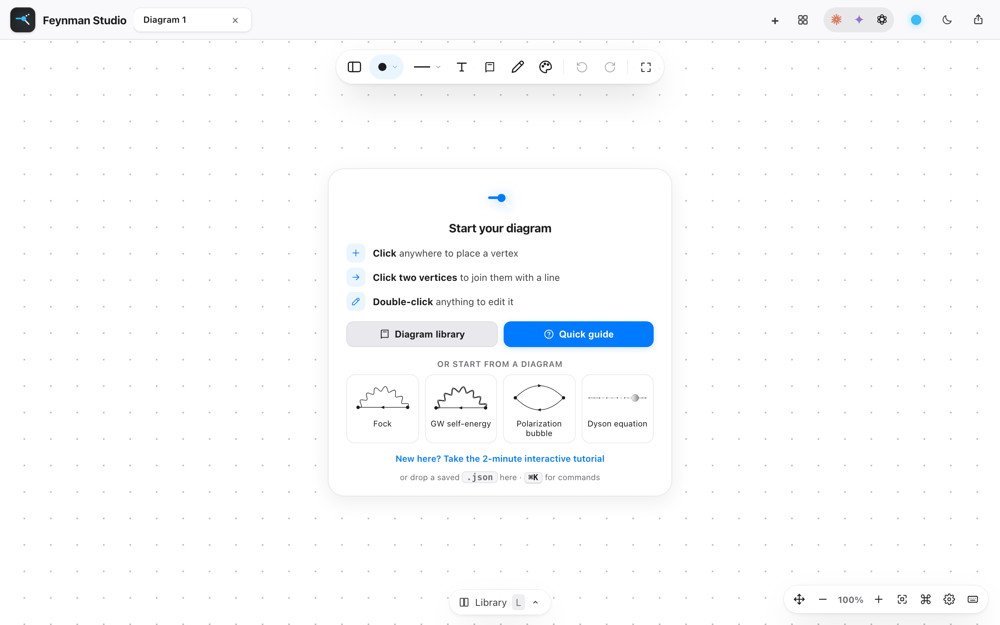
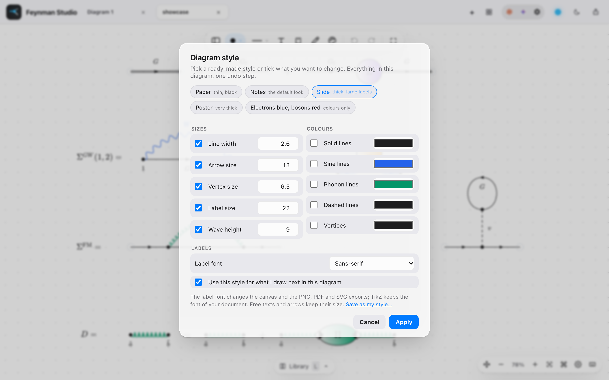
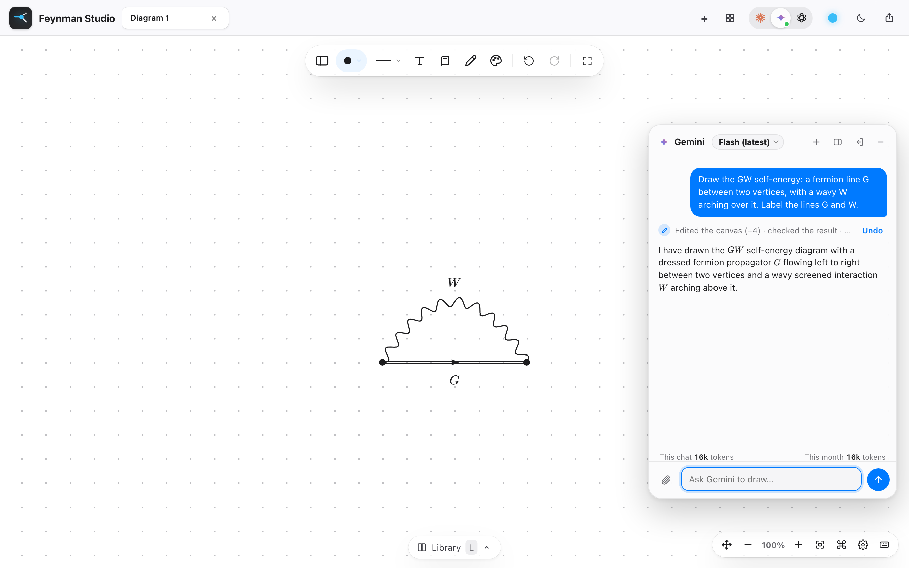
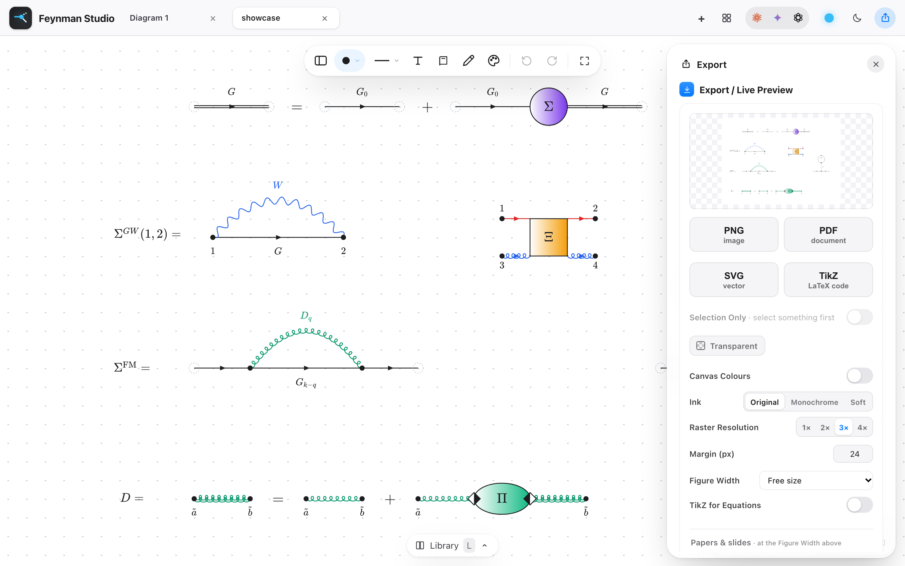
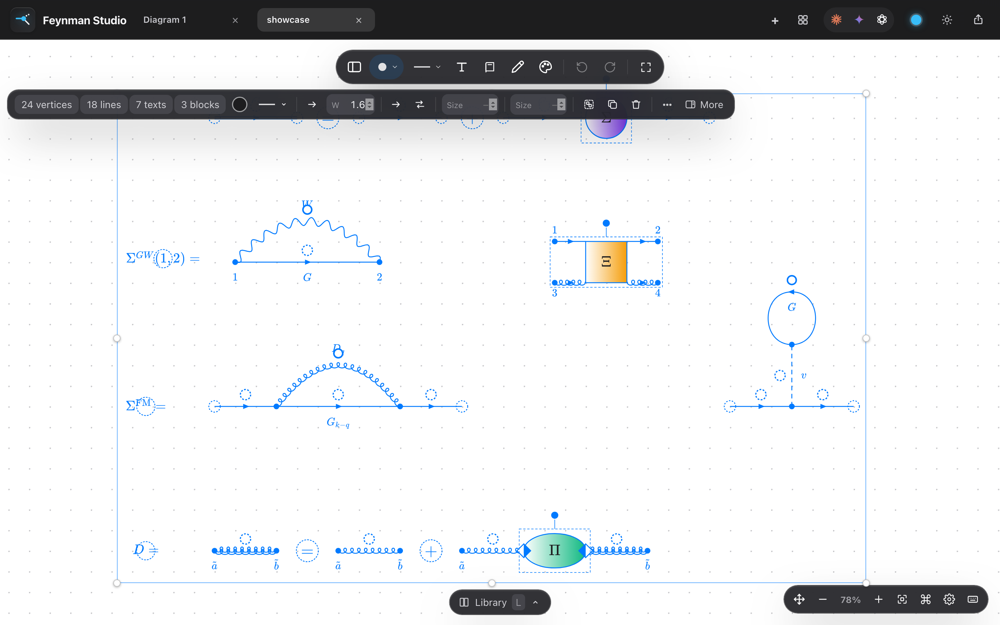
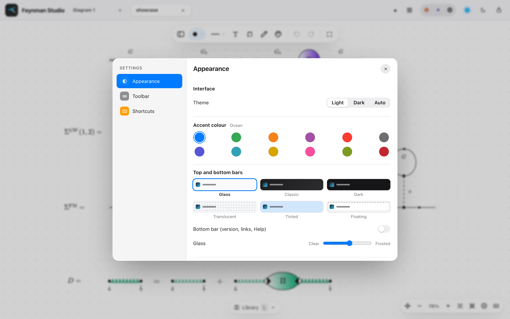

<p align="center">
  
</p>

<h1 align="center">Feynman Studio</h1>

<p align="center">
  <b>A diagram editor for many-body physics.</b><br>
  Draw Green's functions, self-energies, phonon propagators and vertex kernels,<br>
  label them in LaTeX, and export them to TikZ, SVG, PDF or PNG.
</p>

<p align="center">
  <a href="https://alessandromoreci.github.io/Feynman-Studio/feynman_studio.html"></a>
  &nbsp;
  <a href="#install-it-as-an-app"></a>
  &nbsp;
  <a href="https://github.com/alessandromoreci/Feynman-Studio/wiki"></a>
</p>

<p align="center">
  <sub>Version 3.2 · one HTML file · macOS, Windows and Linux · no account · your diagrams never leave your computer</sub>
</p>

<br>

<p align="center">
  
</p>

<br>

## Contents

- [What it is](#what-it-is)
- [How it works](#how-it-works)
- [What you can do with it](#what-you-can-do-with-it)
- [Draw with AI](#draw-with-ai)
- [Export](#export)
- [Make it yours](#make-it-yours)
- [Install it as an app](#install-it-as-an-app)
- [Privacy and security](#privacy-and-security)
- [Keyboard shortcuts](#keyboard-shortcuts)
- [Files in this repository](#files-in-this-repository)
- [License](#license)

<br>

## What it is

Feynman Studio is made for the diagrams of **condensed-matter and many-body theory**: Green's functions and their Dyson equations, self-energies (Hartree, Fock, *GW*, Fan–Migdal, Debye–Waller), polarizations and screened interactions, phonon propagators, vertex functions and two-particle kernels, in and out of equilibrium.

It is a drawing program that knows what a diagram is. Lines stay attached to their vertices, labels are real LaTeX, and what you export is ready for a paper, a thesis or a slide.

| You are preparing… | What helps |
|---|---|
| **A paper** | TikZ code that compiles as it is, figures at the real column width, labels in the font of your document |
| **A thesis** | one style for every diagram, your own templates, versions to go back to, all diagrams exported at once |
| **Slides and posters** | ready-made *Slide* and *Poster* styles, PNG up to 4×, transparent background, copy as image |
| **A talk** | *Present* mode: your tabs as full-screen slides |
| **Non-equilibrium work** | Keldysh components on lines and Keldysh branches on vertices |
| **Electron–phonon theory** | the phonon propagator as a spring and the coupling *g* as a rhombus |

<br>

## How it works

1. **Click** on the canvas to place a vertex. **Click two vertices** to join them with a line.
2. **Click** any element to select it: its main properties appear in a small bar right above it. The rest is behind **…** and **More**.
3. Press <kbd>L</kbd> for the **Library** of ready-made diagrams, or pick one from the start screen.
4. Press <kbd>⌘</kbd>/<kbd>Ctrl</kbd>+<kbd>E</kbd> to **export**, <kbd>⌘</kbd>/<kbd>Ctrl</kbd>+<kbd>S</kbd> to **save** the editable project as a `.json` file.

<p align="center">
  
</p>

An illustrated guide is built in (**Help**, in the logo menu), and every action of the app can be found by typing its name in the command palette (<kbd>⌘</kbd>/<kbd>Ctrl</kbd>+<kbd>K</kbd>).

<br>

## What you can do with it

### Draw

- **Vertices** in 40 shapes, each with up to four LaTeX labels; external vertices where a line just ends.
- **Lines** in ten styles: solid, dashed, dotted, dash-dot, sine, square wave, zig-zag, coil, gluon and phonon. Straight or bent, single or double, with arrows.
- **Kernel blocks**: boxes, circles, ellipses and triangles with two to six legs, for self-energies, polarizations and vertex functions.
- **Free text** in LaTeX, curved arrows, and small icons that explain a diagram (where it is cut, what is included).

### Draw faster

- **Sketch** (<kbd>P</kbd>): draw freehand. A stroke becomes a line, a bent one an arc, a closed one a bubble; a row of dashes a dashed line, a row of dots a dotted one; a wave a sine line, curls a gluon line.
- **Insert into a line**: drag a Fock, bubble or Hartree diagram from the Library onto a line and it is turned along the line and spliced into it.
- **Arrange as equation**: diagrams and texts are put on one row, centred and evenly spaced, with `=` and `+` added between them.
- **Tidy up**: rows and columns are straightened, spacings made equal, arcs made symmetric.

### Keep it consistent

- **Diagram style**: ready-made looks for a paper, a slide or a poster, a label font, and one colour per kind of line. Save your own; what you draw next takes the same style.
- **Copy and paste style**, groups, lock, align and distribute, flip and rotate, find and replace in labels.
- **Tabs**, **versions** of a diagram, your own **templates**, and a **share link** that carries the whole diagram without uploading anything.

<p align="center">
  
</p>

<br>

## Draw with AI

`feynman_studio.html` adds three assistants at the top right: **Claude**, **Gemini** and **ChatGPT**. Ask in plain words and the assistant draws on the canvas, or changes what is already there.

<p align="center">
  
</p>

- **It works on your diagram.** The assistant reads the canvas, edits it and looks at the result. A whole reply is one undo step.
- **It reads pictures.** Attach a photo or a screenshot of a diagram and ask for it to be redrawn.
- **Right-click an element** and choose *Ask Claude / Gemini / ChatGPT About This…* to talk about the selection.
- **You bring your own key.** Each assistant needs an API key from its provider (Anthropic, Google or OpenAI); you pay the provider directly for what you use, and the window shows the tokens spent.

The key is kept in memory only: it is never written to disk and it is gone when you close the app. See [Privacy and security](#privacy-and-security).

The assistants are optional: without a key the app works exactly the same, and nothing is sent anywhere.

<br>

## Export

<p align="center">
  
</p>

| Format | For |
|---|---|
| **TikZ** | LaTeX code that compiles as it is; *Copy for Overleaf* wraps it in a figure, *Copy for Beamer* in a slide |
| **TikZ-Feynman** | the same diagram written with the `tikz-feynman` package: named vertices and edges such as `fermion`, `photon`, `gluon`, easy to edit by hand |
| **PDF / SVG** | vector figures, with the labels typeset exactly as in LaTeX |
| **PNG** | up to 4×, transparent background if you like |
| **Project (.json)** | the editable diagram, to open again later |

*Figure Width* gives the figure the real size of your document (one or two APS columns, thesis, custom). You can export only the selection, or every tab at once.

<br>

## Make it yours

Light and dark themes, twelve accent colours, several canvases and bar styles. **Settings** (<kbd>⌘</kbd>/<kbd>Ctrl</kbd>+<kbd>,</kbd>) also lets you choose which tools sit in the toolbar, in which order, and the letter of each single-key shortcut.

<p align="center">
  
  
</p>

<br>

## Install it as an app

Feynman Studio is a single HTML file, so there are two ways to use it.

### 1 · In the browser, with nothing to install

Download `feynman_studio.html` and double-click it. It opens in your browser and works offline.

### 2 · As a desktop app, with its own icon and window

`build_app.py` turns the page into an application for the computer it is run on. You need **Python 3** and the files of this repository.

```
python3 build_app.py
```

The app appears in the `dist` folder.

| System | What you get | What you need |
|---|---|---|
| **macOS** | `Feynman Studio.app`, a native window (Apple Silicon and Intel). Add `--install` to copy it to Applications and open it. | Apple's Command Line Tools; the script offers to install them if they are missing |
| **Windows** | `Feynman Studio.exe`, a single file | an internet connection the first time (the script downloads its build tools) |
| **Linux** | `feynman-studio`, a single file, with an icon and a menu entry | an internet connection the first time |

An app built on a Mac runs on Macs, one built on Windows runs on Windows: run the script once on each kind of computer you want an app for. Run it again whenever the page changes.

> **First launch.** The app is not signed with a paid developer certificate, so the system asks for confirmation the first time: on macOS right-click the app and choose **Open**; on Windows click **More info → Run anyway**.

> **Status.** The macOS build has been built and launched. The Windows and Linux builds use the same script but have not been tried on those systems yet: reports are welcome.

Other options: `--html` packages another page, `--icon` uses another logo, `--engine web` builds on a Mac the same kind of app made for Windows and Linux.

<br>

## Privacy and security

- **Nothing is uploaded.** Diagrams live in the page and in the files you save. The only network traffic is the one you start by talking to an assistant, and it goes straight from your computer to the provider you chose.
- **API keys stay in memory.** They are never written to disk, to the browser storage or to project files, and they are erased when the window closes. A key of one provider is refused by the others.
- **The page runs only its own code.** A Content-Security-Policy lists the fingerprint of every script in the file and allows connections to three addresses only: `api.anthropic.com`, `generativelanguage.googleapis.com` and `api.openai.com`.
- **Files from others are cleaned on the way in.** Project files, share links and saved sessions pass through the same checks before anything is drawn.

If you change a script inside `feynman_studio.html`, run `python3 csp-update.py` afterwards: it recomputes the fingerprints. Without it the browser refuses the changed script and the page stays empty.

<br>

## Keyboard shortcuts

| Key | Action |
|---|---|
| <kbd>⌘</kbd>/<kbd>Ctrl</kbd>+<kbd>K</kbd> | command palette: search any action |
| <kbd>1</kbd> … <kbd>9</kbd>, <kbd>0</kbd> | line style, of the selection or of the next lines |
| <kbd>L</kbd> · <kbd>P</kbd> · <kbd>F</kbd> | Library · Sketch · focus mode |
| <kbd>X</kbd> · <kbd>R</kbd> · <kbd>E</kbd> · <kbd>M</kbd> | vertex on a line · rotate · external vertex · mirror a pattern |
| <kbd>⌘</kbd>/<kbd>Ctrl</kbd>+<kbd>J</kbd> | show or hide the assistant |
| <kbd>⌘</kbd>/<kbd>Ctrl</kbd>+<kbd>E</kbd> · <kbd>S</kbd> · <kbd>O</kbd> | export · save project · open project |
| <kbd>⌘</kbd>/<kbd>Ctrl</kbd>+<kbd>,</kbd> | Settings |

The full list is behind the keyboard button of the zoom bar. Single-letter shortcuts can be changed in Settings.

<br>

## Files in this repository

| File | What it is |
|---|---|
| `feynman_studio.html` | the app: one file, with the AI assistants |
| `index.html` | a three-line page that forwards old links to `feynman_studio.html` |
| `build_app.py` | builds the desktop app |
| `app/` | what the build needs: the logo (`icon.png`) and the native macOS window (`main.swift`) |
| `csp-update.py` | recomputes the script fingerprints of `feynman_studio.html` after an edit |
| `docs/` | the pictures of this page |

<br>

## License

MIT © Alessandro Moreci. See [`LICENSE`](LICENSE).
