<div align="center">

# Feynman Studio

**Draw many-body Feynman diagrams in the browser and export them to LaTeX/TikZ, SVG, PDF or PNG.**

Green's functions, self-energies, vertex kernels and interaction lines, with LaTeX labels typeset live.<br>
It is a single HTML file: nothing to install and no account, and it works offline once loaded.

[**Open the app**](https://alessandromoreci.github.io/Feynman-Studio/) · [Features](#features) · [Quick start](#quick-start) · [Shortcuts](#keyboard-shortcuts) · [TikZ export](#export)


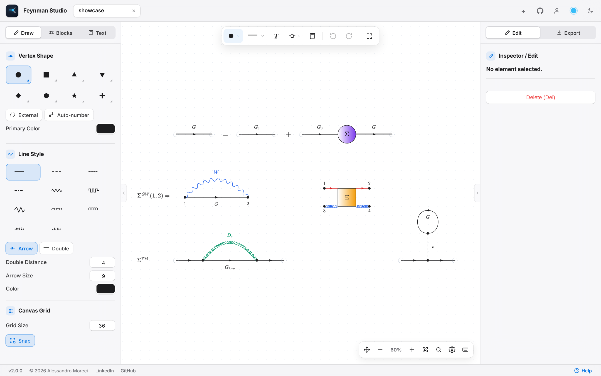

</div>

---

## Why

Diagrammatic many-body theory, covering non-equilibrium Green's functions, electron–phonon coupling, *GW* and Bethe–Salpeter, is full of diagrams. Most people draw them by hand-tuning TikZ code or in a vector editor that knows nothing about propagators. Feynman Studio is built for this one task:

- vertices snap to a grid and lines follow them;
- wavy, coiled and phonon lines always start and end exactly on their vertices;
- every label is LaTeX;
- the export looks exactly like the canvas, and the TikZ output drops straight into your paper or thesis.

<div align="center">
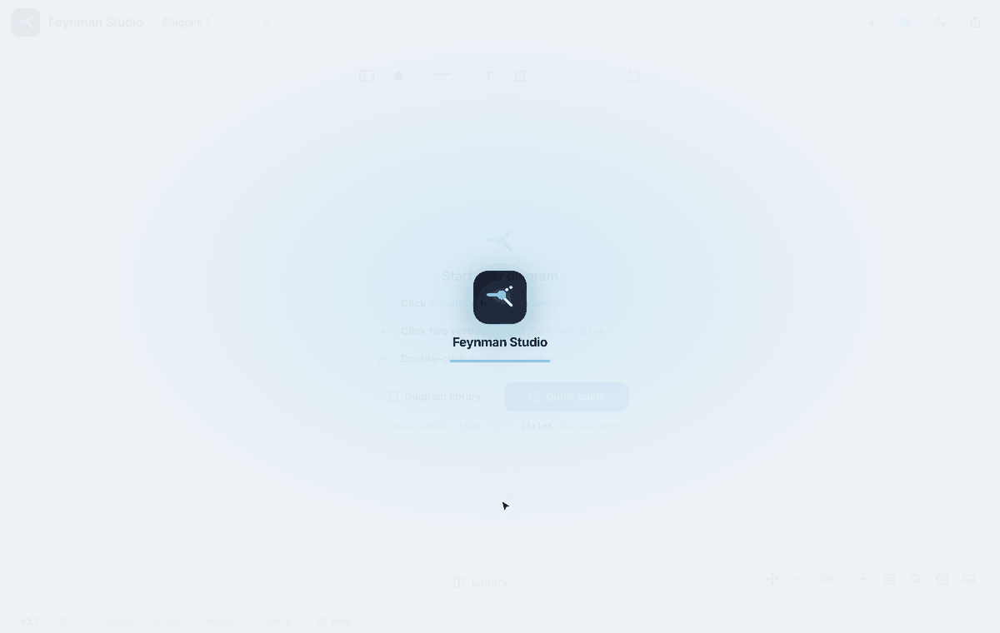
</div>

---

## Features

### Lines for every propagator

There are eleven line styles: fermion, interaction, photon, gluon and two phonon variants, among others. The number of waves or curls adapts to the length of the line, and asymmetric patterns can be mirrored with `M`. Arrows sit in the middle of the line, and lines can be double, curved or closed into self-loops.

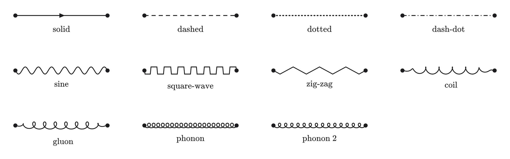

### Kernels and vertex blocks

Composite blocks represent vertex functions, self-energies and four-point kernels:

- **Bodies:** box, grid box, circle, ellipse, isosceles or right triangle.
- **Legs:** 2, 4 or 6 per block.
- **Fill and border:** solid, gradient (horizontal, vertical, diagonal or radial) or no fill; grid or hatch pattern; solid, dashed or dotted border.
- **Each leg separately:** line style, colour, arrow direction, length, and position along the side. You can also drag the handle in the middle of a leg.
- Lines attached to a block follow it when you move, rotate or mirror it.

<table>
<tr>
<td width="55%">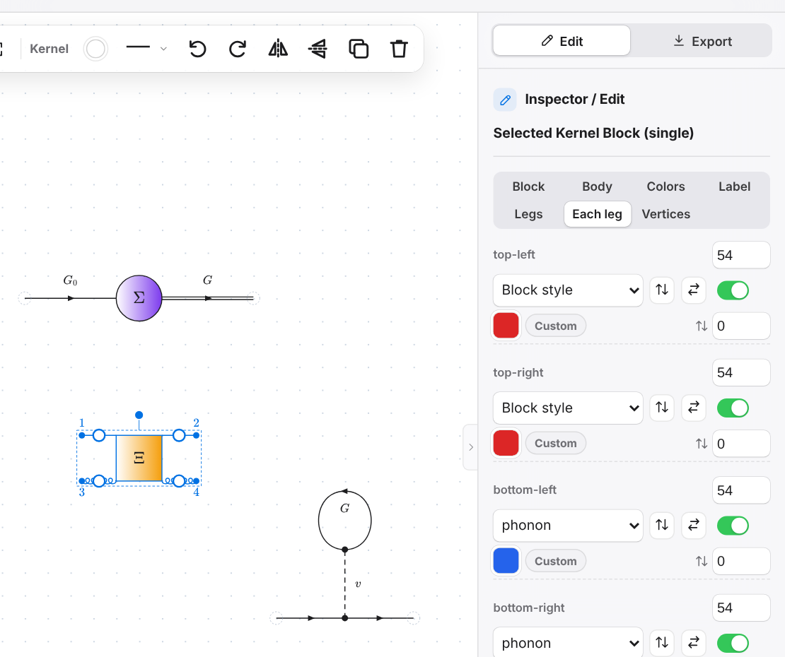</td>
<td width="45%">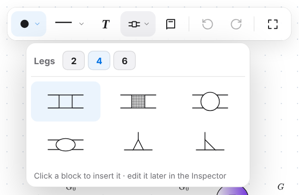<br><br>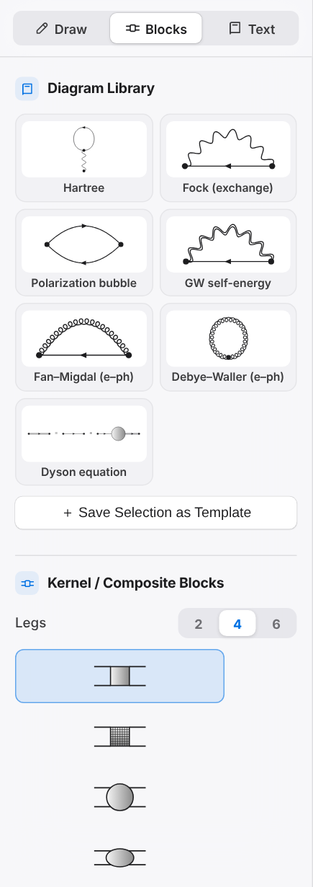</td>
</tr>
</table>

### Diagram library

Ready-made diagrams for Hartree, Fock, the polarization bubble, *GW*, Fan–Migdal, Debye–Waller and the Dyson equation. They are inserted without labels, so you can add your own notation. You can save any selection as your own template.

### LaTeX everywhere

- Vertex labels (four per vertex), line labels, kernel and leg labels, and free text are all LaTeX, typeset live with KaTeX.
- **Double-click a label on the canvas** to edit it in place.
- Labels have their own colour, or follow the colour of their vertex.

### Editing that stays out of the way

- **Smart guides** in the style of Keynote show alignment and equal spacing, with the distance.
- **Select a whole diagram** with `Alt`+click.
- **Mirror and rotate** any selection exactly, including kernels and wavy lines.
- **Duplicate**, or right-click → *Duplicate Mirrored* for symmetric diagrams.
- **Layers** control which element is drawn on top.
- **Tool dock** above the canvas: vertex shape, line style, text, kernels, library and undo/redo. When something is selected it also shows colour, style, arrow, rotate/flip, duplicate and delete.
- **Command palette** with `Ctrl/⌘ + K`: type what you want to do.
- **Inspector** with one section at a time, and numeric fields you can **drag** to change.
- **Undo** for every drag and every edit (the last 100 steps).

<table>
<tr>
<td width="50%">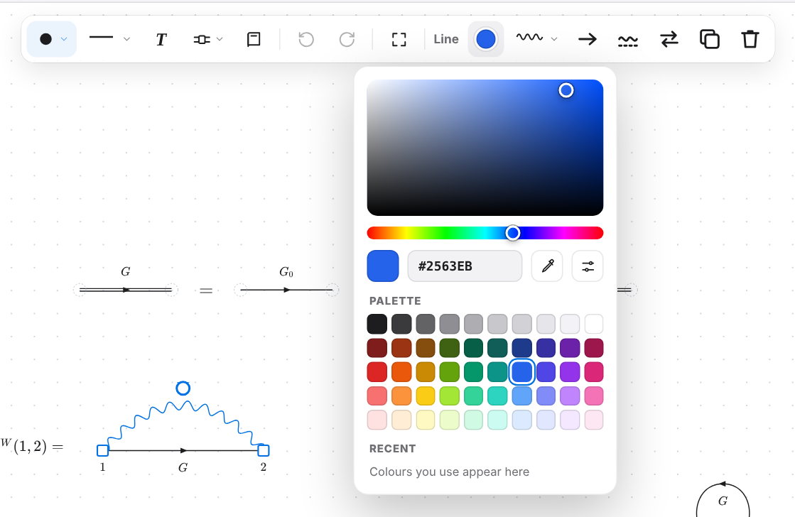</td>
<td width="50%">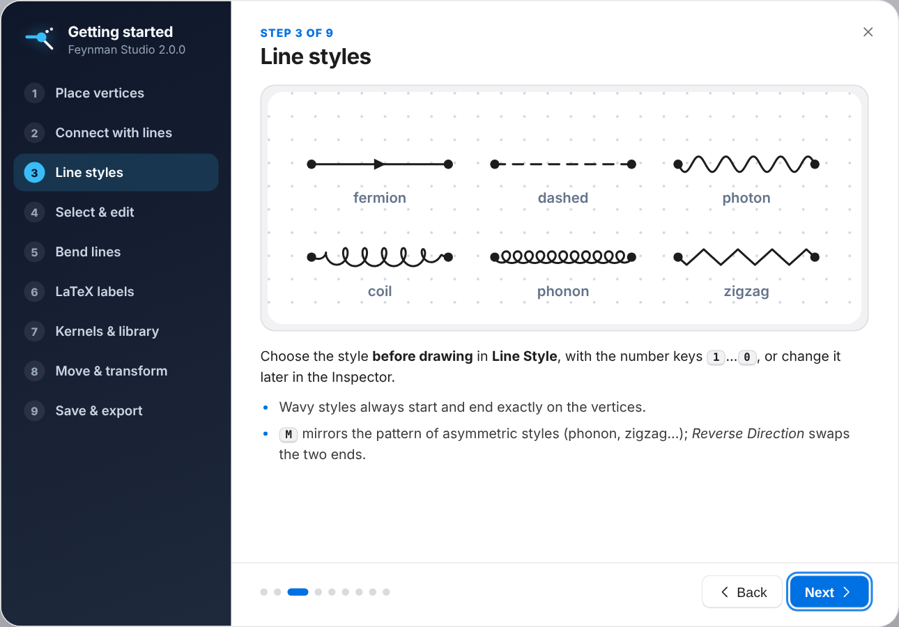</td>
</tr>
</table>

### Export

| Format | What you get |
|---|---|
| **TikZ / LaTeX** | Readable code for `\begin{tikzpicture}` with arrows in the middle of the lines, exact curves, gradients and per-leg colours. |
| **SVG** | Vector graphics with the LaTeX labels converted to paths, exactly as on screen. |
| **PDF / PNG** | Cropped to the diagram with your chosen margin, from 1× to 8×, with an optional transparent background. |
| **Clipboard** | `Ctrl/⌘ + Shift + C` copies the diagram, or only the selection, as an image. |
| **Project (.json)** | The fully editable diagram. Open it again with `Ctrl/⌘ + O` or by dropping it on the canvas. |

An optional *Check diagram* step runs before exporting and flags overlapping labels, duplicated elements, stray vertices and LaTeX errors.

<details>
<summary><b>Example of TikZ output</b> (the <i>GW</i> self-energy above)</summary>

```latex
% Requires: \usepackage{tikz}
% \usetikzlibrary{arrows.meta, decorations.pathmorphing, decorations.markings, calc, shadings}
\definecolor{fscA}{HTML}{2563EB}
\begin{tikzpicture}[scale=0.9]
\draw[] (94.32,-62.64) .. controls (96.00,-62.64) and (97.68,-62.64) .. node[pos=0.5, below right, font=\fontsize{12.0pt}{12.0pt}\selectfont] {$G$} (99.36,-62.64);
\path[postaction={decorate, decoration={markings, mark=at position 0.50 with {\arrow[line width=0.6pt]{Stealth[length=3.1mm]}}}}] (94.32,-62.64) .. controls (96.00,-62.64) and (97.68,-62.64) .. (99.36,-62.64);
\draw[draw=fscA, decorate,decoration={snake,amplitude=1mm,segment length=2.6mm}] (94.32,-62.64) .. controls (96.00,-60.75) and (97.68,-60.75) .. node[pos=0.5, above left, font=\fontsize{12.0pt}{12.0pt}\selectfont] {$W$} (99.36,-62.64);
\filldraw[black] (94.32,-62.64) circle (0.10);
\node[anchor=north, font=\fontsize{12.0pt}{12.0pt}\selectfont] at ($(94.32,-62.64)+(0.00, -0.25)$) {$1$};
\filldraw[black] (99.36,-62.64) circle (0.10);
\node[anchor=north, font=\fontsize{12.0pt}{12.0pt}\selectfont] at ($(99.36,-62.64)+(0.00, -0.25)$) {$2$};
\end{tikzpicture}
```

The whole showcase diagram, exported to TikZ and compiled with `pdflatex`:

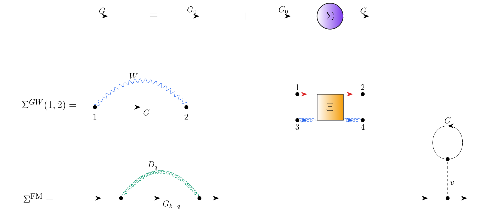
</details>

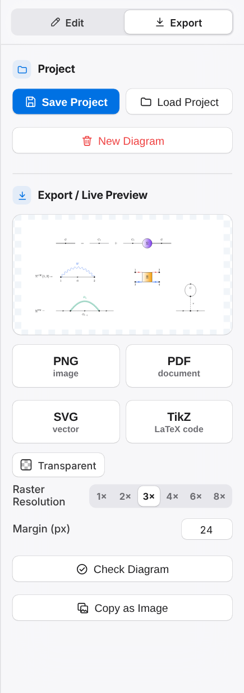

### A calm interface

- **Light or dark** mode, and six colour themes: Ocean, Forest, Sunset, Violet, Rose and Graphite. The canvas and the exports always stay black on white.
- **Tabs** for several diagrams at once, each with its own undo history and view.
- **Session recovery** after an accidental close, reopening every tab at its zoom and position.
- **Focus mode** with `F` hides the panels.
- **Smooth zoom and pan**: pinch, trackpad, `Space`+drag, minimap.
- A **built-in illustrated guide** under **Help** in the bottom bar.

<br clear="right">

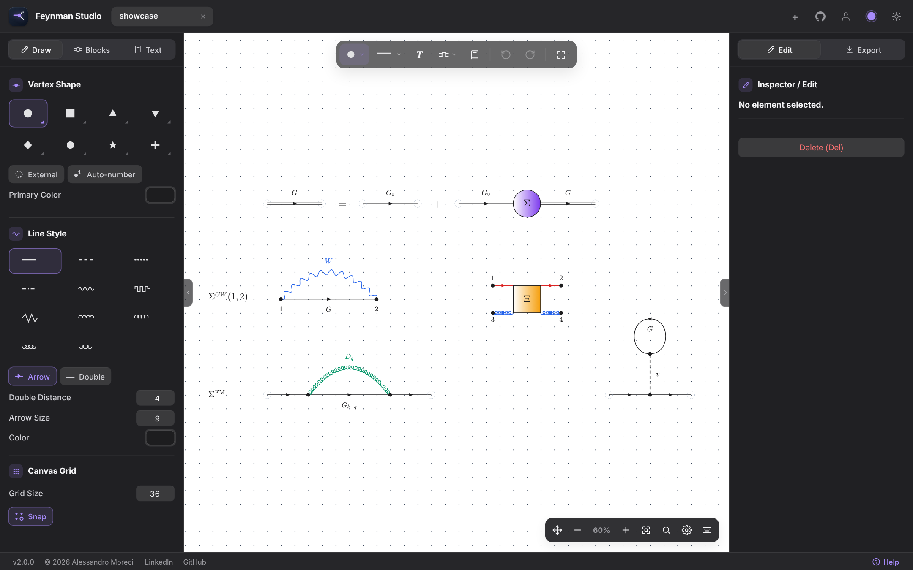

---

## Quick start

1. **Open the app** at the [GitHub Pages link](https://alessandromoreci.github.io/Feynman-Studio/), or download `index.html` and double-click it.
2. **Click** on the canvas to place a vertex, then **click two vertices** to join them with a line.
3. Pick the line style in the dock or with the number keys `1`…`0`.
4. **Double-click** anything to edit it in the Inspector, or double-click a label to edit it in place.
5. Go to **Export** and choose TikZ, SVG, PDF or PNG. Save the editable project as `.json` with `Ctrl/⌘ + S`.

Need more? Click **Help** in the bottom bar for a nine-step illustrated guide.

To see a complete example, open [`examples/showcase.json`](examples/showcase.json), the diagram in the screenshots, with **Export → Load Project** or by dropping it on the canvas.

> **Offline use.** Everything runs locally in your browser. KaTeX, MathJax and jsPDF are loaded from a CDN the first time the page opens. Without a connection, labels fall back to a simple Unicode rendering.

---

## Keyboard shortcuts

On macOS, use `⌘` instead of `Ctrl` and `⌥` instead of `Alt`.

| Action | Shortcut |
|---|---|
| Undo / redo | `Ctrl+Z` / `Ctrl+Shift+Z` |
| Copy / paste / duplicate | `Ctrl+C` / `Ctrl+V` / `Ctrl+D` |
| Save / open project | `Ctrl+S` / `Ctrl+O` |
| Command palette | `Ctrl+K` |
| Line style (selection or next line) | `1` … `9`, `0`, `Shift+0` |
| Mirror the pattern of a line | `M` |
| External (transparent) vertex | `E` |
| Flip horizontally / vertically | `Shift+H` / `Shift+V` |
| Rotate 90° clockwise / counter-clockwise | `R` / `Shift+R` |
| Select the whole connected diagram | `Alt+click` |
| Place off the grid while dragging | hold `Alt` |
| Move the selection (grid step / fine) | arrow keys / `Shift`+arrows |
| Bring forward / send backward | `Ctrl+]` / `Ctrl+[` |
| Copy as image | `Ctrl+Shift+C` |
| Focus mode | `F` |
| Cancel / deselect / close | `Esc` |
| Zoom / pan | pinch or `Ctrl`+scroll / `Space`+drag |

---

## Under the hood

- **One file:** `index.html` contains the whole application in plain HTML, CSS and JavaScript, with no build step and no framework.
- **[KaTeX](https://katex.org)** typesets the labels on the canvas, **[MathJax](https://www.mathjax.org)** turns them into vector paths for SVG/PDF/PNG, and **[jsPDF](https://github.com/parallax/jsPDF)** writes the PDF files.
- **Privacy:** diagrams never leave your computer. The app stores only interface preferences, recent colours and an automatic recovery copy in your browser's local storage.

## Contributing

Bug reports and ideas are very welcome. Please [open an issue](https://github.com/alessandromoreci/Feynman-Studio/issues) and, if possible, attach the `.json` project that shows the problem.

## Citing

If Feynman Studio helped with the figures of a paper or thesis, a mention is appreciated:

```bibtex
@misc{moreci_feynmanstudio,
  author       = {Moreci, Alessandro},
  title        = {Feynman Studio: a web editor for many-body Feynman diagrams},
  year         = {2026},
  howpublished = {\url{https://github.com/alessandromoreci/Feynman-Studio}},
  note         = {Version 2.0.0}
}
```

## Author

**Alessandro Moreci**, PhD student in theoretical condensed-matter physics at the University of Rome Tor Vergata.<br>
[LinkedIn](https://www.linkedin.com/in/alessandro-moreci-a35bbb247/) · [GitHub](https://github.com/alessandromoreci) · [alessandromoreci27@gmail.com](mailto:alessandromoreci27@gmail.com)
