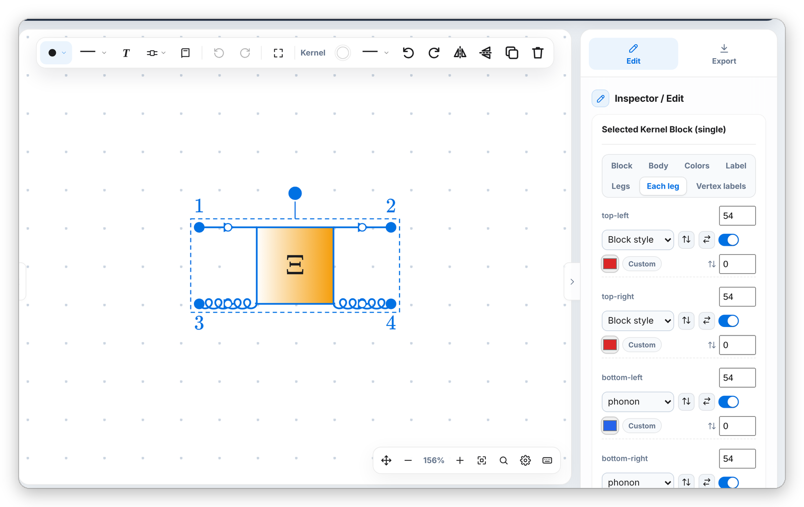
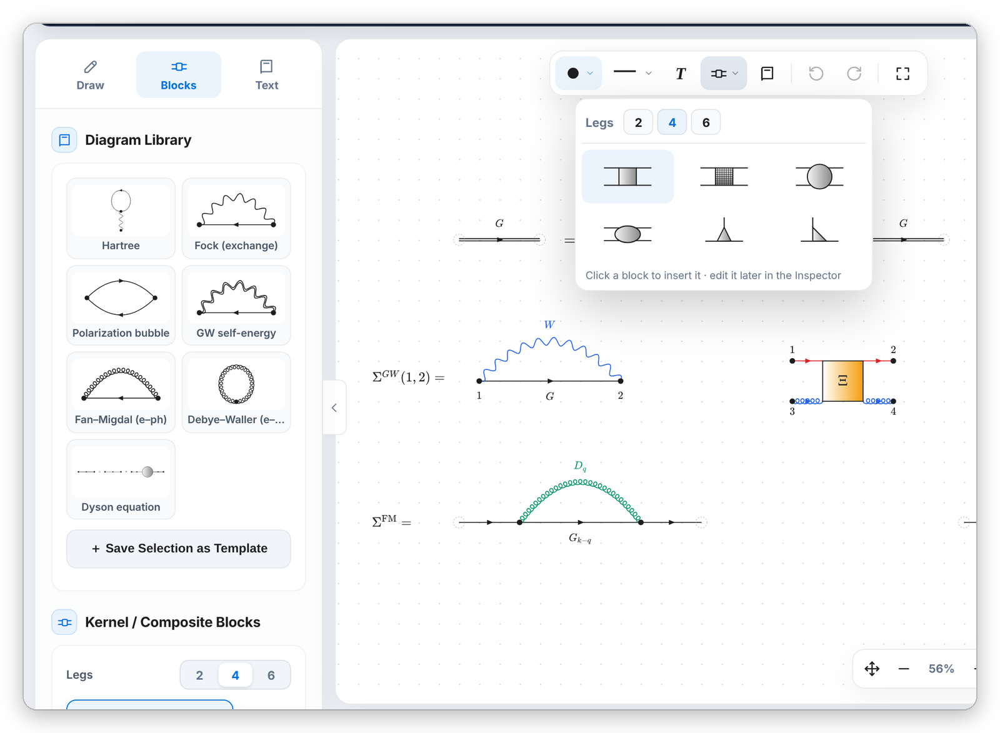
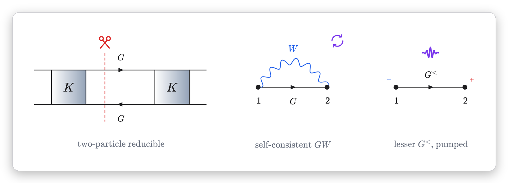
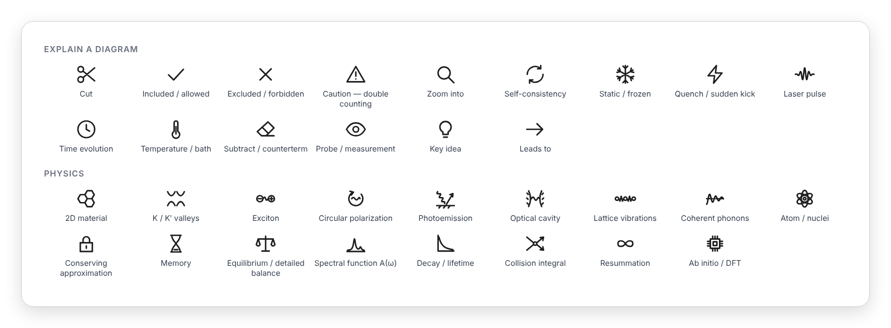
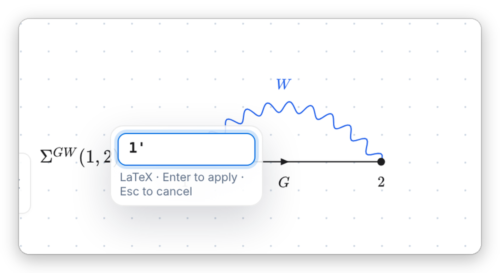

<p align="center">
  
</p>

<h1 align="center">Feynman Studio</h1>

<p align="center">
  <b>A diagram editor for many-body physics.</b><br>
  Draw Green's functions, self-energies and vertex kernels, label them in LaTeX,<br>
  and export to TikZ, SVG, PDF or PNG, all inside your browser.
</p>

<p align="center">
  <a href="https://alessandromoreci.github.io/Feynman-Studio/"></a>
  &nbsp;
  <a href="https://github.com/alessandromoreci/Feynman-Studio/archive/refs/heads/main.zip"></a>
</p>

<p align="center">
  <sub>Version 2.2.0 · one HTML file · no installation · no account · your diagrams never leave your computer</sub>
</p>

<br>

<p align="center">
  
</p>

<br>

## Draw a diagram in seconds

Click to place a vertex and click two vertices to connect them. Choose the propagator from the bar above the canvas, bend the line by dragging its handle, then colour and label it. Lines always start and end exactly on their vertices, and everything snaps to the grid.

<p align="center">
  
</p>

<br>

## Every propagator you need

The app has eleven line styles: fermion, interaction, photon, gluon and two phonon variants, among others. The number of waves and curls adapts to the length of the line, and asymmetric patterns can be mirrored with <kbd>M</kbd>. Lines can carry an arrow, be doubled, bent into arcs or closed into self-loops.

<p align="center">
  
</p>

<br>

## Kernels, built leg by leg

Vertex functions, self-energy blobs and four-point kernels are single blocks with 2, 4 or 6 legs. The body can be a box, a grid box, a circle, an ellipse or a triangle, with a solid, gradient or patterned fill.

**Every leg is independent:** it has its own line style, colour, arrow direction, length and position along the side. You can set these in the Inspector, or drag the handle in the middle of a leg on the canvas. Lines attached to a block follow it when you move, rotate or mirror it.

<p align="center">
  
</p>

<br>

## A library to start from

Ready-made diagrams for Hartree, Fock, the polarization bubble, *GW*, Fan–Migdal, Debye–Waller, the Dyson equation and the Keldysh contour. They come without labels, so you can add your own notation. Save any selection as a template of your own. Every kernel type is also one click away in the bar above the canvas.

<p align="center">
  
</p>

<br>

## Icons and Keldysh notation

Small pictures help to explain a diagram on a slide or in a paper. **Scissors** show where a diagram is cut, so you can point out that it is one- or two-particle reducible. There are also icons for *included* and *excluded* diagrams, *double counting*, *zoom into a block*, *self-consistency*, *static* quantities, a *quench*, a *laser pulse*, *time evolution*, *temperature*, a *counterterm*, a *probe*, a *key idea* and an arrow. A second set draws the physics itself: a honeycomb lattice, K / K′ valleys, an exciton, circularly polarized light, photoemission, an optical cavity, lattice vibrations, coherent phonons, an atom, and pictures for a *conserving approximation*, *memory effects*, *detailed balance*, the *spectral function*, a *lifetime*, the *collision integral*, a *resummation* and an *ab initio* calculation. You can move, rotate, resize and colour every icon like any text, and they are exported to every format, TikZ included.

For non-equilibrium diagrams, every line can carry its **Keldysh component** (&lt;, &gt;, R, A, M, T, T̄, ⌉, ⌈), which is added to its label, and every vertex can carry its **contour branch** (−, +, M). The Keldysh contour itself is in the library.

<p align="center">
  
</p>

<p align="center">
  
</p>

<br>

## LaTeX, right where you need it



Every label is LaTeX, typeset live: vertex labels, line labels, kernel labels and free text. **Double-click a label to edit it in place** on the canvas; <kbd>Enter</kbd> applies the change and <kbd>Esc</kbd> cancels it.

There is a symbol palette with search (*alpha*, *sum*, *hbar*…) and a row of recently used symbols. Labels can follow the colour of their vertex or have their own.

Under every label field there are **ready-made labels** (*G*, *G*₀, *W*, *v*, Σ, Π, *D*…), with the one that fits the line style outlined, and you can add your own. **Number Vertices** writes 1, 2 on the end points and 3̄, 4̄ on the internal vertices, the integrated variables.

<br clear="right">

<br>

## Made for editing, not fiddling

<p align="center">
  
</p>

- **Tool bar:** vertex shape, line style, text, kernels and library are always at hand. When something is selected, the bar also shows its own tools: colour, style, arrow, mirror, rotate, duplicate and delete.
- **Colour picker:** every colour has a palette, a hex field, an eyedropper and your recent colours.
- **Smart guides:** while you drag, guides in the style of Keynote show alignment and equal spacing.
- **Resize from the selection frame:** select anything, from one icon to a whole diagram, and drag a corner to scale it proportionally, labels and arrows included. Side handles stretch it in one direction.
- **Selection and transforms:** <kbd>Alt</kbd>+click selects a whole connected diagram. You can mirror and rotate exactly, and *Duplicate Mirrored* helps with symmetric diagrams.
- **Inspector:** it shows one section at a time, and you can **drag** a field's name to change its value.
- **Command palette:** with <kbd>Ctrl</kbd>/<kbd>⌘</kbd> + <kbd>K</kbd>, type what you want to do.
- **Smooth motion:** moving icons, blocks or whole diagrams stays fluid even on large drawings. Elements glide between grid points, lift slightly while you drag them, and the view keeps gliding after a quick pan. Dragging towards the edge scrolls the canvas.
- **Undo** works for every drag and every edit.

<br>

## Export for papers, theses and slides

<p align="center">
  
</p>

| Format | Use it for |
|---|---|
| **TikZ** | pasting into a LaTeX document; compiles with `pdflatex` as it is |
| **SVG** | vector figures, with labels converted to paths |
| **PDF / PNG** | from 1× to 8×, cropped to the diagram, optional transparent background |
| **Clipboard** | <kbd>Ctrl</kbd>/<kbd>⌘</kbd>+<kbd>Shift</kbd>+<kbd>C</kbd> straight into slides or notes |
| **Project (.json)** | the editable diagram, to reopen later |

A live preview shows exactly what you will get. An optional check flags overlapping labels, duplicated elements and LaTeX errors before you export.

- **Figure width:** choose one APS column (8.6 cm), two columns (17.8 cm), a thesis page (15 cm) or any width. PNG, PDF and SVG come out at that size and the TikZ code is scaled to it. A dashed box on the canvas shows the real width: if your diagram fills it, the labels print at their true size.
- **TikZ for equations:** the drawing sits on the maths axis and the labels use the font size of your text, so you can write `\Sigma(1,2) = ` followed by the diagram.
- **Share link:** the whole diagram is stored inside a link. Whoever opens it sees the diagram in Feynman Studio, and nothing is uploaded anywhere.

### TikZ that compiles as it is

The TikZ export is readable code you can paste into your document and edit by hand. Arrows sit in the middle of the lines as on the canvas, curves and self-loops are exact, kernels keep their gradients and per-leg colours, and every label lands on the same side as on the canvas. The first lines of the code list what goes in your preamble (`svg.path` is added when the diagram has icons). Here is the *GW* self-energy from the screenshot above:

```latex
% Requires: \usepackage{tikz}  (and \usepackage{amsmath} if your labels use \text, \operatorname, ...)
% \usetikzlibrary{arrows.meta, decorations.pathmorphing, decorations.markings, calc, shadings}
\definecolor{fscA}{HTML}{2563EB}
\begin{tikzpicture}[scale=0.9]
\draw[] (94.32,-62.64) .. controls (96.00,-62.64) and (97.68,-62.64) .. node[pos=0.5, auto, swap, inner sep=5pt, font=\fontsize{12.0pt}{12.0pt}\selectfont] {$G$} (99.36,-62.64);
\path[postaction={decorate, decoration={markings, mark=at position 0.50 with {\arrow[line width=0.6pt]{Stealth[length=3.1mm]}}}}] (94.32,-62.64) .. controls (96.00,-62.64) and (97.68,-62.64) .. (99.36,-62.64);
\draw[draw=fscA, decorate,decoration={snake,amplitude=1mm,segment length=2.6mm}] (94.32,-62.64) .. controls (96.00,-60.75) and (97.68,-60.75) .. node[pos=0.5, auto, inner sep=6pt, font=\fontsize{12.0pt}{12.0pt}\selectfont] {$W$} (99.36,-62.64);
\filldraw[black] (94.32,-62.64) circle (0.10);
\node[anchor=north, font=\fontsize{12.0pt}{12.0pt}\selectfont] at ($(94.32,-62.64)+(0.00, -0.25)$) {$1$};
\filldraw[black] (99.36,-62.64) circle (0.10);
\node[anchor=north, font=\fontsize{12.0pt}{12.0pt}\selectfont] at ($(99.36,-62.64)+(0.00, -0.25)$) {$2$};
\end{tikzpicture}
```

And this is the whole showcase diagram, exported to TikZ and compiled with `pdflatex`, with no changes:

<p align="center">
  
</p>

<br>

## Light, dark and six colour themes

The interface can be light or dark, with an accent of your choice: Ocean, Forest, Sunset, Violet, Rose or Graphite. The canvas and the exported figures always stay black on white.

<p align="center">
  
</p>

<br>

## Getting started

1. **[Open the app](https://alessandromoreci.github.io/Feynman-Studio/)**, or download `index.html` and double-click it.
2. **Click** on the canvas to place vertices, then **click two vertices** to connect them.
3. **Double-click** any element to edit it, or a label to retype it.
4. Open **Export** in the right panel and choose your format. Save the editable project with <kbd>Ctrl</kbd>/<kbd>⌘</kbd> + <kbd>S</kbd>.

To see a full example, open [`examples/showcase.json`](examples/showcase.json), the diagram shown above. An illustrated nine-step guide is always available under **Help** in the bottom bar.

<p align="center">
  
</p>

<details>
<summary><b>Keyboard shortcuts</b></summary>
<br>

On macOS, use <kbd>⌘</kbd> instead of <kbd>Ctrl</kbd> and <kbd>⌥</kbd> instead of <kbd>Alt</kbd>.

| Action | Shortcut |
|---|---|
| Undo / redo | <kbd>Ctrl</kbd>+<kbd>Z</kbd> · <kbd>Ctrl</kbd>+<kbd>Shift</kbd>+<kbd>Z</kbd> |
| Copy / paste / duplicate | <kbd>Ctrl</kbd>+<kbd>C</kbd> · <kbd>Ctrl</kbd>+<kbd>V</kbd> · <kbd>Ctrl</kbd>+<kbd>D</kbd> |
| Save / open project | <kbd>Ctrl</kbd>+<kbd>S</kbd> · <kbd>Ctrl</kbd>+<kbd>O</kbd> |
| Command palette | <kbd>Ctrl</kbd>+<kbd>K</kbd> |
| Line style | <kbd>1</kbd> … <kbd>9</kbd>, <kbd>0</kbd>, <kbd>Shift</kbd>+<kbd>0</kbd> |
| Mirror a line's pattern | <kbd>M</kbd> |
| External (transparent) vertex | <kbd>E</kbd> |
| Flip horizontally / vertically | <kbd>Shift</kbd>+<kbd>H</kbd> · <kbd>Shift</kbd>+<kbd>V</kbd> |
| Rotate 90° | <kbd>R</kbd> · <kbd>Shift</kbd>+<kbd>R</kbd> |
| Select the whole diagram | <kbd>Alt</kbd>+click |
| Place off the grid | hold <kbd>Alt</kbd> while dragging |
| Nudge the selection | arrow keys · <kbd>Shift</kbd>+arrows |
| Bring forward / send backward | <kbd>Ctrl</kbd>+<kbd>]</kbd> · <kbd>Ctrl</kbd>+<kbd>[</kbd> |
| Copy as image | <kbd>Ctrl</kbd>+<kbd>Shift</kbd>+<kbd>C</kbd> |
| Focus mode | <kbd>F</kbd> |
| Zoom / pan | pinch or <kbd>Ctrl</kbd>+scroll · <kbd>Space</kbd>+drag |

</details>

<details>
<summary><b>How it works</b></summary>
<br>

- The whole application is a single file, `index.html`, written in plain HTML, CSS and JavaScript with no build step.
- Labels are typeset with [KaTeX](https://katex.org) on the canvas and with [MathJax](https://www.mathjax.org) for the exported figures. PDFs are written with [jsPDF](https://github.com/parallax/jsPDF). These libraries load from a CDN the first time the page opens.
- Nothing is uploaded anywhere. Your browser keeps only your interface preferences and a recovery copy of the open diagrams.

</details>

<br>

## Citing Feynman Studio

If the app helped with the figures of a paper or thesis, a mention is appreciated:

```bibtex
@misc{FeynmanStudio,
  author       = {Moreci, Alessandro},
  title        = {{Feynman Studio}: a web editor for many-body {F}eynman diagrams},
  year         = {2026},
  version      = {2.2.0},
  howpublished = {\url{https://github.com/alessandromoreci/Feynman-Studio}}
}
```

## Feedback

Found a bug or have an idea? [Open an issue](https://github.com/alessandromoreci/Feynman-Studio/issues) and, if you can, attach the `.json` project that shows it.

<br>

<p align="center">
  Made by <a href="https://github.com/alessandromoreci"><b>Alessandro Moreci</b></a>, PhD student in theoretical condensed-matter physics at the University of Rome Tor Vergata<br>
  <a href="https://www.linkedin.com/in/alessandro-moreci-a35bbb247/">LinkedIn</a> · <a href="mailto:alessandromoreci27@gmail.com">Email</a>
</p>
