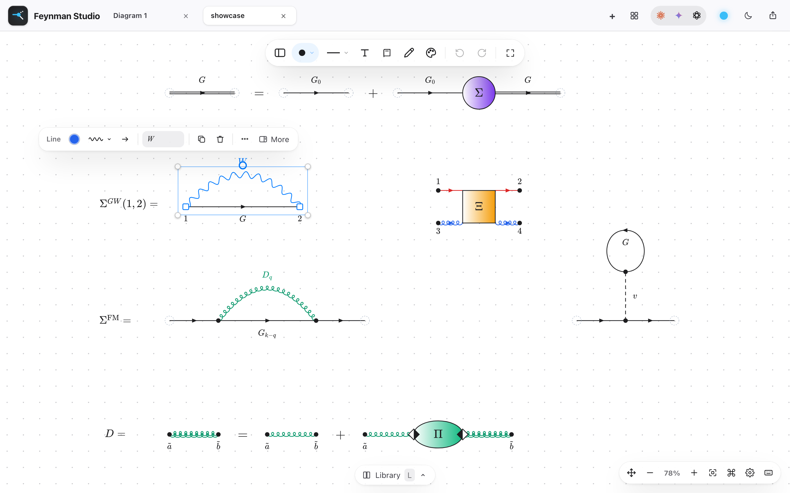
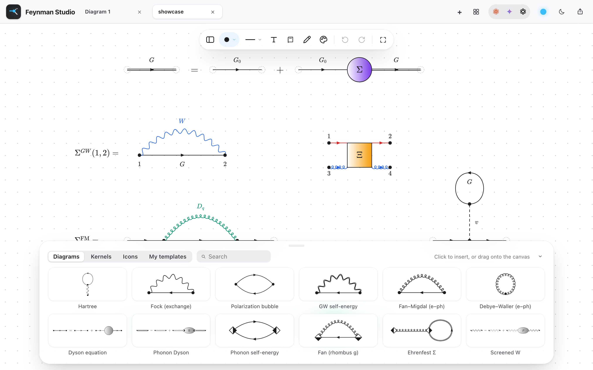

<p align="center">
  
</p>

<h1 align="center">Feynman Studio</h1>

<p align="center">
  <b>A diagram editor for many-body physics.</b><br>
  Draw Green's functions, self-energies, phonon propagators and vertex kernels,<br>
  label them in LaTeX, and export them to TikZ, SVG, PDF or PNG.
</p>

<p align="center">
  <a href="https://alessandromoreci.github.io/Feynman-Studio/feynman_studio.html"></a>
  &nbsp;
  <a href="#install-it-as-an-app"></a>
  &nbsp;
  <a href="#citing-feynman-studio"></a>
</p>

<p align="center">
  <sub>Version 3.2 · one HTML file · macOS, Windows and Linux · no account · your diagrams never leave your computer</sub>
</p>

<br>

<p align="center">
  
</p>

<br>

## Contents

- [Draw with AI](#draw-with-ai)
- [What it is](#what-it-is)
- [How it works](#how-it-works)
- [Drawing](#drawing) — vertices, lines, kernels, LaTeX, arrows and icons
- [Drawing faster](#drawing-faster) — sketch, insert into a line, equations, tidy up
- [Physics notation](#physics-notation) — Keldysh contour, electron–phonon, physics check
- [Editing](#editing) — selection bar, diagram style, groups, guides
- [The Library and your templates](#the-library-and-your-templates)
- [Export](#export)
- [Projects, tabs, versions and sharing](#projects-tabs-versions-and-sharing)
- [Make it yours](#make-it-yours)
- [Install it as an app](#install-it-as-an-app)
- [Privacy and security](#privacy-and-security)
- [Keyboard shortcuts](#keyboard-shortcuts)
- [Tips](#tips)
- [Citing Feynman Studio](#citing-feynman-studio)
- [Feedback](#feedback)

<br>

## Draw with AI

Three assistants live at the top right of the window: **Claude**, **Gemini** and **ChatGPT**. Describe the diagram in plain words — *“the GW self-energy, G below and a wavy W arching over it”* — and the assistant draws it on the canvas. Then keep talking: *“make W blue”*, *“add the vertex correction”*, *“turn it into a Dyson equation”*.

<p align="center">
  
</p>

- **It works on your diagram, not on a picture of it.** The assistant reads the canvas, edits real vertices and lines, then looks at the result and corrects itself. What it draws is as editable as what you draw.
- **One reply, one undo.** If you do not like what it did, *Undo* next to the reply takes it all back.
- **Choose the model.** Each assistant offers its models, from the fastest to the most capable; every model keeps its own conversation for each diagram.
- **Formulas in the answers** are typeset, like the labels on the canvas.
- **It reads pictures.** Attach a photo or a screenshot of a diagram and ask for it to be redrawn.
- **Right-click an element** and choose *Ask Claude / Gemini / ChatGPT About This…* to talk about the selection.
- **You bring your own key.** Each assistant needs an API key from its provider (Anthropic, Google or OpenAI); you pay the provider directly for what you use, and the window shows the tokens spent.

The key is kept in memory only: it is never written to disk and it is gone when you close the app. See [Privacy and security](#privacy-and-security).

The assistants are optional: without a key the app works exactly the same, and nothing is sent anywhere.

<br>

## What it is

Feynman Studio is made for the diagrams of **condensed-matter and many-body theory**: Green's functions and their Dyson equations, self-energies (Hartree, Fock, *GW*, Fan–Migdal, Debye–Waller), polarizations and screened interactions, phonon propagators, vertex functions and two-particle kernels, in and out of equilibrium.

It is a drawing program that knows what a diagram is. Lines stay attached to their vertices, labels are real LaTeX, and what you export is ready for a paper, a thesis or a slide.

| You are preparing… | What helps |
|---|---|
| **A paper** | TikZ code that compiles as it is, figures at the real column width, labels in the font of your document |
| **A thesis** | one style for every diagram, your own templates, versions to go back to, all diagrams exported at once |
| **Slides and posters** | ready-made *Slide* and *Poster* styles, PNG up to 4×, transparent background, copy as image |
| **A talk** | *Present* mode: your tabs as full-screen slides |
| **Non-equilibrium work** | Keldysh components on lines and Keldysh branches on vertices |
| **Electron–phonon theory** | the phonon propagator as a spring and the coupling *g* as a rhombus |

<br>

## How it works

1. **Click** on the canvas to place a vertex. **Click two vertices** to join them with a line.
2. **Click** any element to select it: its main properties appear in a small bar right above it. The rest is behind **…** and **More**.
3. Press <kbd>L</kbd> for the **Library** of ready-made diagrams, or pick one from the start screen.
4. Press <kbd>⌘</kbd>/<kbd>Ctrl</kbd>+<kbd>E</kbd> to **export**, <kbd>⌘</kbd>/<kbd>Ctrl</kbd>+<kbd>S</kbd> to **save** the editable project as a `.json` file.

<p align="center">
  
</p>

An illustrated guide is built in (**Help**, in the logo menu), and every action of the app can be found by typing its name in the command palette (<kbd>⌘</kbd>/<kbd>Ctrl</kbd>+<kbd>K</kbd>).

<br>

## Drawing

### Vertices

- **40 shapes** in eight families — circles, squares, triangles, diamonds, hexagons, stars and crosses — filled, outlined, concentric or in two colours.
- **Four LaTeX labels** per vertex (top, bottom, left, right), each one draggable.
- **External vertices** (<kbd>E</kbd>): transparent points where a line just ends.
- **Auto-numbering**: 1, 2, 3… or 1, 2, 3̄, 4̄.

### Lines

- **Ten styles**: solid (fermion), dashed, dotted, dash-dot, sine (photon, interaction), square wave, zig-zag, coil, gluon and phonon. Keys <kbd>1</kbd> … <kbd>9</kbd>, <kbd>0</kbd> set the style of the selection or of the next lines.
- **Arrows** halfway along the line, **double lines** for dressed propagators, a **width** per line.
- **Curves and loops**: drag the middle of a line to bend it; a line from a vertex to itself is a tadpole.
- **Waves that fit**: the number of waves adapts to the length; height and length can be set, asymmetric patterns mirrored with <kbd>M</kbd>.
- **A vertex inside a line**: select it and press <kbd>X</kbd> — a self-energy insertion in two seconds.
- **Reconnect** a line by dragging one of its ends onto another vertex.

### Kernels

Vertex functions, self-energy blobs and two-particle kernels are **single blocks** with 2, 4 or 6 legs (3 for triangles): box, circle, ellipse or triangle; solid or gradient fill; a pattern inside; a LaTeX label. Every leg has its own style, colour, arrow and length, and the lines attached to a block follow it when you move, rotate or mirror it.

### Text, arrows and icons

- **Every label is LaTeX**, typeset live. Double-click a label to edit it on the canvas; a symbol palette and label presets (*G*, *G*₀, *W*, Σ, Π, *D*…) are one click away.
- **Free text** anywhere, for equations such as *Σ(1,2) =* next to a diagram.
- **Curved arrows** with a text along them, to point at a part of a diagram.
- **36 icons** that *explain* a diagram: scissors where it is cut, included / excluded, self-consistency, quench, laser pulse, exciton, phonons, spectral function…

<br>

## Drawing faster

- **Sketch** (the pencil, or <kbd>P</kbd>): draw freehand and the app cleans it up.

  | You draw | You get |
  |---|---|
  | a stroke | a line (an arc if it is bent) |
  | a closed loop | a bubble on two vertices |
  | a row of dashes, of dots, or dashes and dots | a dashed, dotted or dash-dot line |
  | a wave | a sine line |
  | sharp teeth, or steps | a zig-zag, or a square wave |
  | curls | a gluon line (a coil or a phonon if that is the style chosen in the toolbar) |

- **Insert into a line**: drag a Fock, bubble, Hartree or Fan–Migdal diagram from the Library onto a straight line. It is turned along the line and spliced into it, arrows in the right direction.
- **Arrange as equation**: diagrams and texts are put on one row, centred and evenly spaced, with `=` and `+` added between them. Run it again after adding a term.
- **Tidy up**: rows and columns are straightened, spacings made equal, arcs made symmetric.
- **Start from a diagram**: the start screen and the Library hold twelve ready-made diagrams, without labels, ready for your notation.

<br>

## Physics notation

- **Keldysh component of a line**: <, >, R, A, M, T, T̄, ⌉, ⌈, written as a superscript of its label (*G* → *G*<sup><</sup>).
- **Keldysh branch of a vertex**: forward (−), backward (+) or Matsubara (M), shown as a small mark next to the vertex. <kbd>K</kbd> cycles it.
- **Electron–phonon diagrams** in the notation of Stefanucci and Perfetto: the phonon propagator *D* as a **spring**, the coupling *g* as a **rhombus** whose black half holds the electron vertex, Π as a block.
- **A physics check** before exporting: overlapping labels, stray elements, LaTeX errors — and **fermion arrows that do not balance at a vertex**.

<br>

## Editing

<p align="center">
  
</p>

- **Selection bar**: right above what you select, with the few properties you change most. **…** shows the rest (transform, lock, copy style, group), **More** opens the full Inspector. Every change is one undo step.
- **Select** with a click, add with <kbd>Shift</kbd>+click, drag a box on the empty canvas, <kbd>Alt</kbd>+click for a whole connected diagram.
- **Diagram style**: ready-made looks for a paper, a slide or a poster, the label font, and one colour per kind of line. Save your own; what you draw next takes the same style.

<p align="center">
  
</p>

- **Copy and paste style** between elements: how they look, never what they are or where they are.
- **Groups** (<kbd>⌘</kbd>/<kbd>Ctrl</kbd>+<kbd>G</kbd>) keep an equation and its diagram together; **Lock** keeps a finished diagram in place.
- **Smart guides** show alignments and equal spacing while you drag; everything snaps to the grid, or hold <kbd>Alt</kbd> to place freely.
- **Resize** from the selection frame, **flip and rotate**, **align and distribute**, *Duplicate Mirrored* for symmetric diagrams, layers.
- **Undo** for every drag and every edit.

<br>

## The Library and your templates

<p align="center">
  
</p>

Press <kbd>L</kbd> and search by name. Click a tile to insert it, or drag it where you want it.

- **Diagrams**: Hartree, Fock, polarization bubble, *GW*, Fan–Migdal, Debye–Waller, Dyson equation, phonon Dyson equation, phonon self-energy, Fan with rhombus vertices, Ehrenfest self-energy, screened interaction *W*.
- **Kernels** of every shape, with the number of legs and the pattern chosen at the top.
- **Icons**, in two groups: *Explain a diagram* and *Physics*.
- **My templates**: select part of a diagram and save it. Templates can be exported to a file and shared with colleagues.

<br>

## Export

<p align="center">
  
</p>

| Format | For |
|---|---|
| **TikZ** | LaTeX code that compiles as it is; *Copy for Overleaf* wraps it in a figure, *Copy for Beamer* in a slide |
| **TikZ-Feynman** | the same diagram written with the `tikz-feynman` package: named vertices and edges such as `fermion`, `photon`, `gluon`, easy to edit by hand |
| **PDF / SVG** | vector figures, with the labels typeset exactly as in LaTeX |
| **PNG** | up to 4×, transparent background if you like |
| **Project (.json)** | the editable diagram, to open again later |

*Figure Width* gives the figure the real size of your document (one or two APS columns, thesis, custom). You can export only the selection, or every tab at once.

<br>

## Projects, tabs, versions and sharing

- **Tabs**: several diagrams open at once, each with its own undo. Hover a tab for a preview, press <kbd>O</kbd> to see them all.
- **Versions**: named snapshots of a diagram to go back to, kept inside the project file.
- **Find and replace in labels**, in one diagram or in all of them — for when you change notation.
- **Present**: the tabs become full-screen slides; ← and → move between them.
- **Animate**: a video of the diagram being drawn piece by piece, for talks.
- **Share link**: the whole diagram travels inside the link. Nothing is uploaded anywhere.
- **Recovery**: if the window is closed by accident, the app offers to restore the session.

<br>

## Make it yours

Light and dark themes, twelve accent colours, several canvases and bar styles. **Settings** (<kbd>⌘</kbd>/<kbd>Ctrl</kbd>+<kbd>,</kbd>) also lets you choose which tools sit in the toolbar, in which order, and the letter of each single-key shortcut.

<p align="center">
  
  
</p>

<br>

## Install it as an app

Feynman Studio is a single HTML file, so there are two ways to use it.

### 1 · In the browser, with nothing to install

Download `feynman_studio.html` and double-click it. It opens in your browser and works offline.

### 2 · As a desktop app, with its own icon and window

`build_app.py` turns the page into an application for the computer it is run on. You need **Python 3** and the files of this repository.

```
python3 build_app.py
```

The app appears in the `dist` folder.

| System | What you get | What you need |
|---|---|---|
| **macOS** | `Feynman Studio.app`, a native window (Apple Silicon and Intel). Add `--install` to copy it to Applications and open it. | Apple's Command Line Tools; the script offers to install them if they are missing |
| **Windows** | `Feynman Studio.exe`, a single file | an internet connection the first time (the script downloads its build tools) |
| **Linux** | `feynman-studio`, a single file, with an icon and a menu entry | an internet connection the first time |

An app built on a Mac runs on Macs, one built on Windows runs on Windows: run the script once on each kind of computer you want an app for. Run it again whenever the page changes.

> **First launch.** The app is not signed with a paid developer certificate, so the system asks for confirmation the first time: on macOS right-click the app and choose **Open**; on Windows click **More info → Run anyway**.

> **Status.** The macOS build has been built and launched. The Windows and Linux builds use the same script but have not been tried on those systems yet: reports are welcome.

Other options: `--html` packages another page, `--icon` uses another logo, `--engine web` builds on a Mac the same kind of app made for Windows and Linux.

<br>

## Privacy and security

- **Nothing is uploaded.** Diagrams live in the page and in the files you save. The only network traffic is the one you start by talking to an assistant, and it goes straight from your computer to the provider you chose.
- **API keys stay in memory.** They are never written to disk, to the browser storage or to project files, and they are erased when the window closes. A key of one provider is refused by the others.
- **The page runs only its own code.** A Content-Security-Policy lists the fingerprint of every script in the file and allows connections to three addresses only: `api.anthropic.com`, `generativelanguage.googleapis.com` and `api.openai.com`.
- **Files from others are cleaned on the way in.** Project files, share links and saved sessions pass through the same checks before anything is drawn.

If you change a script inside `feynman_studio.html`, run `python3 csp-update.py` afterwards: it recomputes the fingerprints. Without it the browser refuses the changed script and the page stays empty.

<br>

## Keyboard shortcuts

| Key | Action |
|---|---|
| <kbd>⌘</kbd>/<kbd>Ctrl</kbd>+<kbd>K</kbd> | command palette: search any action |
| <kbd>1</kbd> … <kbd>9</kbd>, <kbd>0</kbd> | line style, of the selection or of the next lines |
| <kbd>L</kbd> · <kbd>P</kbd> · <kbd>F</kbd> | Library · Sketch · focus mode |
| <kbd>X</kbd> · <kbd>R</kbd> · <kbd>E</kbd> · <kbd>M</kbd> | vertex on a line · rotate · external vertex · mirror a pattern |
| <kbd>⌘</kbd>/<kbd>Ctrl</kbd>+<kbd>J</kbd> | show or hide the assistant |
| <kbd>⌘</kbd>/<kbd>Ctrl</kbd>+<kbd>E</kbd> · <kbd>S</kbd> · <kbd>O</kbd> | export · save project · open project |
| <kbd>⌘</kbd>/<kbd>Ctrl</kbd>+<kbd>,</kbd> | Settings |

The full list is behind the keyboard button of the zoom bar. Single-letter shortcuts can be changed in Settings.

<br>

## Tips

- **Same look everywhere in a thesis**: apply one *Diagram style* to every diagram, save your recurring diagrams as templates, and export them all at once.
- **Labels at the right size in the paper**: set the *Figure Width* first, then fill the dashed box on the canvas.
- **An equation and its diagram that move together**: select both and press <kbd>⌘</kbd>/<kbd>Ctrl</kbd>+<kbd>G</kbd>.
- **Before trying something new**: save a version or duplicate the tab.
- **From a blackboard photo to a clean figure**: attach the photo to an assistant and ask for the diagram to be redrawn, then fix the details by hand.
- **Only one diagram of a busy canvas**: select it and turn on *Selection Only* in Export.

<br>

## Files in this repository

| File | What it is |
|---|---|
| `feynman_studio.html` | the app: one file, with the AI assistants |
| `index.html` | a small page that forwards old links to `feynman_studio.html` |
| `build_app.py` | builds the desktop app |
| `app/` | what the build needs: the logo (`icon.png`) and the native macOS window (`main.swift`) |
| `csp-update.py` | recomputes the script fingerprints of `feynman_studio.html` after an edit |
| `docs/` | the pictures of this page |
| `LICENSE` | MIT licence |

Labels are typeset with [KaTeX](https://katex.org) on the canvas and with [MathJax](https://www.mathjax.org) in the exported figures; PDFs are written with [jsPDF](https://github.com/parallax/jsPDF). All three are inside the file: nothing is loaded from the internet.

<br>

## Citing Feynman Studio

If the app helped with the figures of a paper or a thesis, a mention is appreciated, for instance in BibTeX:

```bibtex
@misc{FeynmanStudio,
  author       = {Moreci, Alessandro},
  title        = {{Feynman Studio}: an editor for many-body {F}eynman diagrams},
  year         = {2026},
  version      = {3.2},
  howpublished = {\url{https://github.com/alessandromoreci/Feynman-Studio}}
}
```

or in words: *Diagrams drawn with Feynman Studio (A. Moreci, 2026), github.com/alessandromoreci/Feynman-Studio.*

<br>

## Feedback

Found a bug or have an idea? [Open an issue](https://github.com/alessandromoreci/Feynman-Studio/issues) and, if you can, attach the `.json` project that shows it. Diagrams for the Library are welcome too.

<br>

## License

MIT © Alessandro Moreci. See [`LICENSE`](LICENSE).

<br>

<p align="center">
  Made by <a href="https://github.com/alessandromoreci"><b>Alessandro Moreci</b></a>, PhD student in theoretical condensed-matter physics at the University of Rome Tor Vergata<br>
  <a href="https://www.linkedin.com/in/alessandro-moreci-a35bbb247/">LinkedIn</a> · <a href="mailto:alessandromoreci27@gmail.com">Email</a>
</p>
